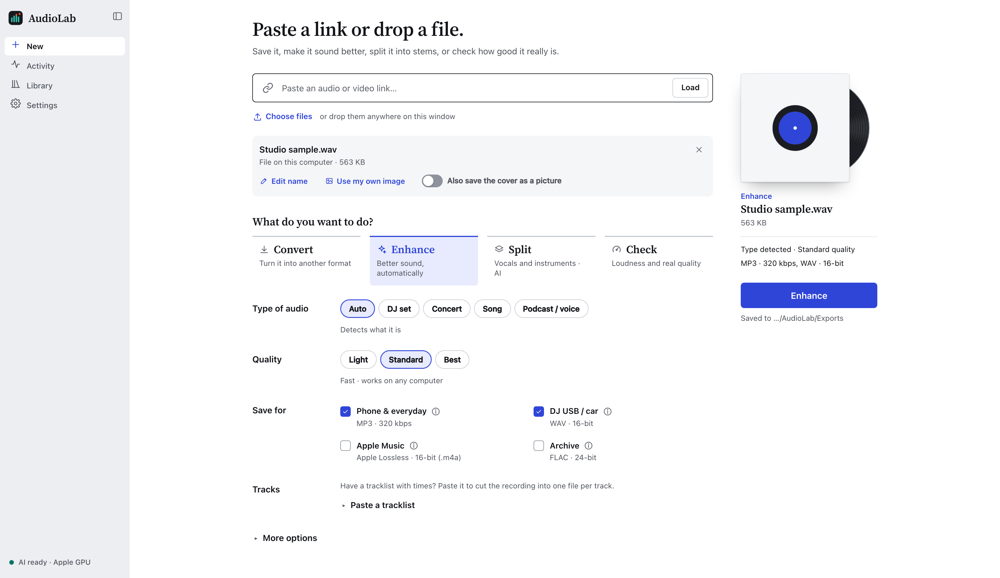

# AudioLab

**Convert, enhance, split and inspect audio on your own computer.**

Work with your recordings, audio/video files and supported web links. Adjust loudness, export useful
formats, separate vocals and instruments, and keep your results together in a local Library.
No AudioLab account or cloud processing service is required.

**2.4 beta:** macOS is the primary platform. Expect rough edges;
please report reproducible problems through [GitHub Issues](https://github.com/JSummerer/AudioLab/issues).
AudioLab is a working project name, not a claim of affiliation with other apps using that name.

## What can I do?

| Task | What it does |
|---|---|
| **Save / Convert** | Convert a file or save audio from a supported link as MP3, M4A, FLAC, WAV, Opus or the original format. |
| **Enhance** | Adjust loudness, tone and peaks using a recipe for music, live recordings or speech. Compare the result with the original. |
| **Split** | Separate vocals and instruments, or make four stems: vocals, drums, bass and other. Requires the optional AI pack. |
| **Check** | Inspect loudness, peaks, dynamics and frequency range; view a spectrogram and estimated tempo/key. |

You can add several files, edit names and cover art, or cut a long recording using chapters or a
tracklist. **Library** keeps finished Save, Enhance and Split results with their versions.
Enhancement cannot restore information missing from a recording; use the comparison player to decide
which version you prefer.

## Mac app for testers

The first downloadable app is **AudioLab Core 2.4.0b1**, for **Apple silicon Macs running macOS 14 or
later**. It includes Python and its audio tools: no Terminal, Python setup or Apple developer account
is needed to use it. Intel binaries are not yet a supported release target.

1. Open [GitHub Releases](https://github.com/JSummerer/AudioLab/releases) and look for the
   **v2.4.0b1 macOS arm64 DMG** under **Assets**. If no DMG is attached, a binary has not been published;
   the automatically generated source ZIP is the [source installation](docs/INSTALLATION.md#install-from-source).
2. Open the DMG and drag **AudioLab.app** into **Applications**. Eject the disk image, then open the app
   from Applications.
3. This beta is ad-hoc signed, without an Apple Developer ID or Apple notarization. macOS may block
   its first opening. After checking the download came from this repository, follow the
   [Open Anyway steps](docs/MACOS.md#first-opening) in System Settings.

The Core app supports **Save / Convert, Check, and Light/Standard Enhance**. **Split and Best Enhance
are unavailable in this package**; there is no in-app AI installation. Processing stays on your Mac.
The release's notes describe the checks actually completed; this guide does not certify an unpublished
or untested artifact. See the [Mac guide](docs/MACOS.md) for opening, updates and safe removal.

## Install from source

Source installation remains available, including optional AI. Download and extract **Code → Download
ZIP**, keep the folder, and follow the [installation guide](docs/INSTALLATION.md#install-from-source).
On macOS, **AudioLab.command** opens Terminal for setup and creates a shortcut app. Windows and Linux
use browser launchers and remain experimental. This source route installs dependencies and may obtain
Python with uv; it is separate from the self-contained Mac app.

## Your first recording

1. Choose **New → Choose files** and select an audio file, or paste a supported web link and press **Load**.
2. Pick **Convert** for a file (**Save** for a link), **Enhance** to process it, or **Check** to inspect it. Defaults are a good
   starting point; **Light** enhancement mainly adjusts volume.
3. Press the main action button. Follow progress in **Activity**, then play or download the result.

Finished audio goes to **`Music/AudioLab`** in your home folder. Change that in **Settings → Files**.
Existing output files are kept; a new result gets a numbered name if needed. Removing a Library entry
only removes its record, not your output files. When enabled, kept original copies live separately in
AudioLab's app-data folder and can be cleared in **Settings → Storage**.

**AI is optional in source installations.** It adds Split and Best enhancement. The downloaded Mac
Core app leaves these out. See [AI size and hardware notes](docs/INSTALLATION.md#optional-ai-in-source-installations)
before enabling it; model weights, installed software, processing memory and temporary audio space
are different requirements.

## Help and feedback

- **Setup stops:** keep the error message and use the [installation troubleshooting steps](docs/INSTALLATION.md#troubleshooting).
- **A job fails:** use **Copy details for a bug report** on the job. For general problems, use
  **Settings → Copy system report**. Include your operating system and the steps that led to the problem.
  Review the report before sharing: filenames, source links or tool output may be personal.
- **Security concern:** follow [SECURITY.md](SECURITY.md) to report it privately.
- **A link fails:** site support varies and can change. For the Mac Core app, check for a newer app release
  or use a local file. Source installations also offer **Update downloader** in Settings. AudioLab does
  not promise support for every site or restricted link.
- **Want more control?** See [usage, command-line and server options](docs/USAGE.md).

Use recordings and links you have permission to process, and follow their licenses and the source
service's terms. AudioLab is not affiliated with any content-hosting service.

## For contributors

Start with [CONTRIBUTING.md](CONTRIBUTING.md). See the [architecture](docs/ARCHITECTURE.md),
[HTTP API](docs/API.md), [changelog](CHANGELOG.md) and [roadmap](docs/ROADMAP.md) for more detail.

Advanced: server settings

These environment variables are for command-line/server setups. Most desktop users can use Settings.

| Variable | Default | Meaning |
|---|---|---|
| `AUDIOLAB_OUTPUT_DIR` | `~/Music/AudioLab` | Where finished files go (locks the setting in the UI) |
| `AUDIOLAB_DATA_DIR` | platform app-data folder | Jobs, settings, tool shims |
| `AUDIOLAB_TOKEN` | auto when not on localhost | Access token; `none` disables it |
| `AUDIOLAB_MAX_CONCURRENT_JOBS` | 1 | Jobs processed at the same time |
| `AUDIOLAB_MAX_DURATION_S` | 28800 | Longest accepted recording |
| `AUDIOLAB_AI_CPU_MAX_DURATION_S` | 1200 | Longest AI job without a GPU (`AUDIOLAB_ALLOW_UNSAFE_AI=1` overrides) |
| `AUDIOLAB_MAX_UPLOAD_MB` / `AUDIOLAB_MAX_DOWNLOAD_MB` | 4096 | Size caps |
| `AUDIOLAB_MAX_PLAYLIST_ITEMS` | 200 | Playlist cap |
| `AUDIOLAB_MIN_FREE_DISK_GB` | 2 | Refuse a job that would leave less free disk |
| `AUDIOLAB_MEMORY_SAFETY_FRACTION` | 0.85 | Share of memory a job may plan to use |
| `AUDIOLAB_RETENTION_DAYS` | 30 | Delete old job records (never your output files) |

Timeouts can also be set: `AUDIOLAB_FFMPEG_TIMEOUT_S`, `AUDIOLAB_YTDLP_PROBE_TIMEOUT_S` and
`AUDIOLAB_YTDLP_DOWNLOAD_TIMEOUT_S`.

## License and credits

AudioLab's code is available under the [MIT license](LICENSE). Dependencies retain their own licenses.
Built with [yt-dlp](https://github.com/yt-dlp/yt-dlp), [FFmpeg](https://ffmpeg.org),
[Demucs](https://github.com/adefossez/demucs), [Deno](https://deno.com), NumPy/SciPy, soundfile,
FastAPI and pywebview. The bundled Source Serif font includes its [license](audiolab/web/fonts/OFL.txt).
The Mac app includes dependency notices and a matching source companion in its release.
Source installations use [imageio-ffmpeg](https://github.com/imageio/imageio-ffmpeg) as a fallback audio engine.
