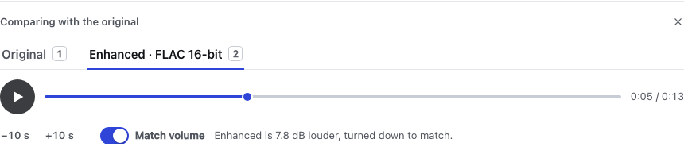

# AudioLab

**Convert, enhance, split and inspect audio on your own computer.**

Work with local files and supported web links. Keep your results together in a Library. No account needed.

## Download for Mac

**[Download the latest release](https://github.com/JSummerer/AudioLab/releases/latest)** (AudioLab 2.5.1)

Apple silicon · macOS 14+ · public beta

1. On the release page, choose the **.dmg** under **Assets**. Open the downloaded file.
2. Drag **AudioLab.app** into **Applications**, then eject the disk image.
3. Open AudioLab from **Applications**. No Terminal or Python setup.

This beta isn't verified by Apple. If macOS blocks the first launch, follow the [Open Anyway guide](docs/MACOS.md#first-opening).
Start with a short recording; see [hardware and tested limits](docs/HARDWARE.md) before trying longer jobs.

**Updating?** Quit AudioLab, download and open the new `.dmg`, then drag **AudioLab.app** into the same
Applications folder as your existing copy. Choose **Replace**, eject the disk image, then reopen AudioLab
and confirm the version in **Settings → About**. Your Library, settings and audio files are stored
separately and carry over. AudioLab tells you when a new version exists; you replace the app yourself.
[Update guide](docs/MACOS.md#updates)

Intel Macs, Windows and Linux have an [experimental source installation](docs/INSTALLATION.md#install-from-source), with no packaged app yet.

## What's new in 2.5.0

- **Adjust:** rework a Library version's EQ on a short passage and hear saved against edited settings.
- **Updates:** Settings says when a newer AudioLab exists, and the Mac app can update its link downloader.
- **Safer files:** a failed or cancelled job leaves no half-finished files behind; finished results stay.
- **Plainer:** a file starts on Enhance, results lead with Show in Finder, and numbers wait under Show
  details. [What changed](CHANGELOG.md)

## What you can do

| Tool | Use it to… |
|---|---|
| **Save / Convert** | Save audio from a supported link or convert files to useful formats. |
| **Enhance** | Choose **Volume only**, **Tone and volume** or **AI stems**, then compare with the original. |
| **Split** | Separate vocals and instruments, or create four stems. Optional AI required. |
| **Check** | Inspect loudness, dynamics and frequency range. |

**Library** keeps finished results and their versions. Add names and cover art, or cut recordings into tracks.
The Mac app can check for a new version and update its link downloader when sites change.

Compare at the same point with **Match volume**. [See the controls](docs/USAGE.md#compare-versions) · [Embed album artwork](docs/USAGE.md#cover-art)

## Optional AI

For **Split** and **Enhance → AI stems**, choose **Settings → Updates & add-ons → Enable AI features** and wait for **Ready**. In the current source checkout this is **Settings → AI add-on**.
The download is about **570 MB**. 2.5.1 reuses a compatible **AI 1.0.0** installation.
You can remove it in Settings later. [AI setup and removal](docs/MACOS.md#optional-ai)

## Guides and help

- **Using the app:** [First recording](docs/USAGE.md#your-first-recording) · [Mac setup](docs/MACOS.md) · [Updates](docs/MACOS.md#updates) · [Uninstall](docs/MACOS.md#uninstall)
- **Need help?** [Troubleshooting](docs/MACOS.md#troubleshooting) · [Report a bug](https://github.com/JSummerer/AudioLab/issues/new?template=bug_report.md) · [Security](SECURITY.md)
- **Advanced use:** [Source installation](docs/INSTALLATION.md#install-from-source) · [Command line and server](docs/USAGE.md#command-line)
- **Contributing:** [Get started](CONTRIBUTING.md) · [Architecture](docs/ARCHITECTURE.md) · [API](docs/API.md) · [Roadmap](docs/ROADMAP.md)

Use recordings and links you have permission to process.

[MIT license](LICENSE) · [Credits](CONTRIBUTING.md#credits) · [Changelog](CHANGELOG.md) · [Release notes](https://github.com/JSummerer/AudioLab/releases/latest)
