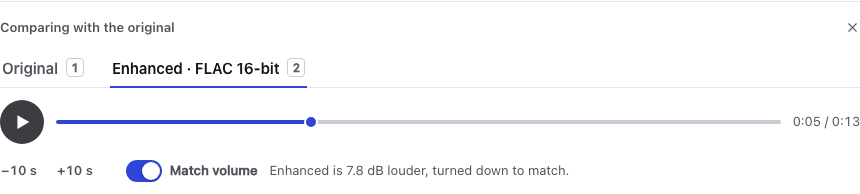

# AudioLab

**Convert, enhance, split and inspect audio on your own computer.**

Work with local files and supported web links. Keep your results together in a Library. No account needed.

## Download for Mac

**[View beta 4 release and downloads](https://github.com/JSummerer/AudioLab/releases/tag/v2.4.0b4)** · [Direct download (.dmg)](https://github.com/JSummerer/AudioLab/releases/download/v2.4.0b4/AudioLab-2.4.0b4-macOS-arm64.dmg)

Apple silicon · macOS 14+ · public beta

1. On the release page, choose the **.dmg** under **Assets**, or use the direct download above. Open the downloaded file.
2. Drag **AudioLab.app** into **Applications**, then eject the disk image.
3. Open AudioLab from **Applications**. No Terminal or Python setup.

This beta isn't verified by Apple. If macOS blocks the first launch, follow the [Open Anyway guide](docs/MACOS.md#first-opening).
Start with a short recording; see [hardware and tested limits](docs/HARDWARE.md) before trying longer jobs.

**Updating?** Quit AudioLab, download and open the new `.dmg` above, then drag **AudioLab.app** into
the same Applications folder as your existing copy. Choose **Replace**, eject the disk image, then reopen
AudioLab and confirm **2.4.0b4** in **Settings → About**. Your Library, settings and audio files are
stored separately and carry over. App updates are manual. [Update guide](docs/MACOS.md#updates)

Intel Macs, Windows and Linux have an [experimental source installation](docs/INSTALLATION.md#install-from-source), with no packaged app yet.

## What's new in beta 4

- Check measures loudness, dynamics and peaks across the whole recording. Enhance also checks the saved exports for loudness and estimated true peak.
- Adaptive processing can reduce brief buildups in the low mids. Added bass harmonics are optional.
- Library keeps the processing details and export checks. Repeat a section while comparing the original and a version with **Match volume**.

## What you can do

| Tool | Use it to… |
|---|---|
| **Save / Convert** | Save audio from a supported link or convert files to useful formats. |
| **Enhance** | Choose **Volume only**, **Adaptive** or **AI stems**, then compare with the original. |
| **Split** | Separate vocals and instruments, or create four stems. Optional AI required. |
| **Check** | Inspect loudness, dynamics and frequency range. |

**Library** keeps finished results and their versions. Add names and cover art, or cut recordings into tracks.

Compare at the same point with **Match volume**. [See the controls](docs/USAGE.md#compare-versions) · [Embed album artwork](docs/USAGE.md#cover-art)

## Optional AI

For **Split** and **Enhance → AI stems**, choose **Settings → AI & system → Enable AI features** and wait for **Ready**.
The download is about **570 MB**. You can remove it in Settings later; the other tools work without it.
See [AI setup and removal](docs/MACOS.md#optional-ai).

## Guides and help

- **Using the app:** [First recording](docs/USAGE.md#your-first-recording) · [Mac setup](docs/MACOS.md) · [Updates](docs/MACOS.md#updates) · [Uninstall](docs/MACOS.md#uninstall)
- **Need help?** [Troubleshooting](docs/MACOS.md#troubleshooting) · [Report a bug](https://github.com/JSummerer/AudioLab/issues/new?template=bug_report.md) · [Security](SECURITY.md)
- **Advanced use:** [Source installation](docs/INSTALLATION.md#install-from-source) · [Command line and server](docs/USAGE.md#command-line)
- **Contributing:** [Get started](CONTRIBUTING.md) · [Architecture](docs/ARCHITECTURE.md) · [API](docs/API.md) · [Roadmap](docs/ROADMAP.md)

Use recordings and links you have permission to process.

[MIT license](LICENSE) · [Credits](CONTRIBUTING.md#credits) · [Changelog](CHANGELOG.md) · [Release notes](https://github.com/JSummerer/AudioLab/releases/tag/v2.4.0b4)
