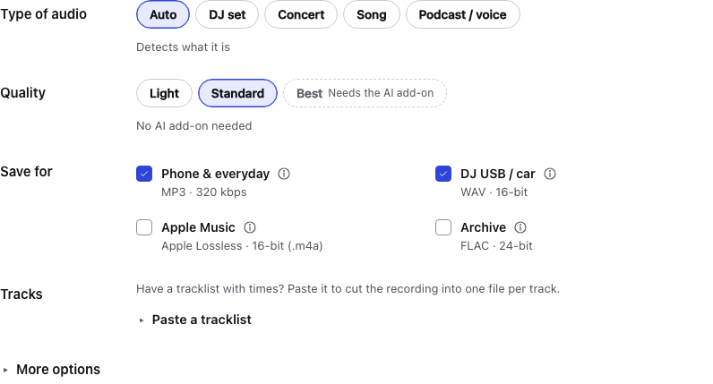
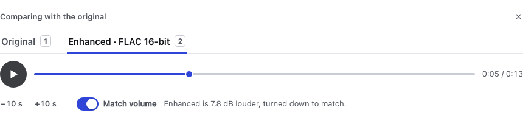

# Using AudioLab

For first-time setup, use the [Mac app guide](MACOS.md) or [source installation guide](INSTALLATION.md#install-from-source).

[First recording](#your-first-recording) · [Sources and results](#sources-and-results) ·
[Enhancement](#automatic-enhancement) · [Cover art](#cover-art) · [Compare versions](#compare-versions) · [Command line](#command-line) ·
[Home server](#docker--home-server) · [Server settings](#server-settings)

## Your first recording

1. Choose **New → Choose files** and select an audio file, or paste a supported web link and press **Load**.
2. A file starts on **Enhance**, a link on **Save**. Pick **Convert** to change a file's format, or **Check**
   to inspect it. Defaults are a good starting point; **Volume only** enhancement mainly adjusts volume.
3. Press the main action button. Follow progress in **Activity**, then play the result or open its folder
   with **Show in Finder** (**Show in folder** on Windows and Linux).

Enhance starts with MP3 on a new install. New takes its format choices from Settings when the page loads.
Choices you make in New carry over between jobs and views until you reload or change that default in Settings.

Finished audio goes to **`Music/AudioLab`** in your home folder. Change that in **Settings → Output defaults**.
Existing output files are kept; a new result gets a numbered name if needed. A job that fails or is
cancelled while still working removes the files it had saved in that attempt, and nothing else; a
finished result is never removed. If AudioLab crashes or is force-quit while a job runs, the files that
attempt had already saved stay in the output folder: AudioLab deliberately never removes output files at
a later start. Two rare limits: on drives without hard links (exFAT or FAT USB sticks, some network
shares), a file another program saves under the very same name in the instant AudioLab claims that name
can be replaced; and when a failed attempt's folder is removed, an empty folder another program creates
at that name in the same instant goes with it. Removing a Library entry preserves your output files, but may remove its kept original
copy when no other entry uses it.
When enabled, kept original copies live separately in AudioLab's app-data folder and can also be
cleared in **Settings → Storage**.

See [optional AI](MACOS.md#optional-ai) for download progress, removal and hardware notes.
The add-on includes both model choices; local files can be processed offline once it is installed.

## Sources and results

Choose local audio/video files or paste a supported web link. Link availability depends on the source
site; a local file is the simplest starting point. For a playlist, choose the items to process.
A link opened from another page (`/?url=…`) waits in the link field until you press **Load**.
Use only material you have permission to process.

In the app window, **Choose files** reads the selected audio and video files where they are. You can
select several at once. **Choose folder** adds up to 50 supported files directly in the chosen folder,
in name order. Each starts its own job. Keep the source on the same drive and path until the job is
finished, or select it again if it moves. Enhance can save a separate original copy for comparisons.
File drops and the browser's file chooser upload the files and use the server's upload limit.
Settings → Files and Library → Add a file use the system picker in the app window. Local browser
sessions use a path field.

- **Save / Convert:** convert formats, save an original stream, or cut chapters/a pasted tracklist into tracks.
- **Enhance:** choose a recipe or use Auto. "Volume only" mainly adjusts volume. "Tone and volume" uses
  the recipe's processing. The available AI option depends on the audio type.
- **Split:** produce vocals/instrumental or four stems using the optional AI pack.
- **Check:** inspect measurements and a spectrogram. Tempo, musical key and content type are estimates.
  Check reports measured loudness and its variation, true peaks, runs near full scale, and the estimated
  frequency range. Near-full-scale runs indicate possible clipping. The report also identifies samples
  above full scale in the floating-point analysis copy.

**More options** holds the name, [cover art](#cover-art), formats and processing controls. **Tracks**
shows up front for a recording with chapters, a pasted tracklist or more than 10 minutes, else under
More options. When AudioLab runs on this computer, results are already in your output folder: finished
jobs and the Library lead with **Show in Finder**. When it runs on another computer, such as a home
server, you download the files instead, or a multi-file result as one ZIP.

Library keeps Save, Enhance and Split results with their versions. When the original is kept, Enhance
offers full-length comparison with matched volume, and later jobs on the same link reuse it instead of
downloading again (Settings → Storage). **Add a file…** brings in a file you already have, such as a
master from your DAW; it stays where it is. Search and sort the Library from its header. A version
offers **Show in Finder** on this computer, and its ⋯ menu holds Open job, Keep only this version and
Remove from Library. A recording's own ⋯ menu holds **Add a version from a file…** (on this computer)
and **Delete the kept original…** (when one is kept). Removing keeps the
files unless you switch on **Also move its files to the Trash**; nothing is ever deleted permanently.
Kept originals use disk space separately from your output folder; manage them in Settings → Storage.

For missing Library files recorded since this feature was added, **Locate…** lets you choose the same
file after moving or renaming it on the same drive. Choose the file with its original extension.
For older entries, or files copied to another drive, use **Add a file…** to add them again.
Locate updates playback and comparison in the Library. Job history stays as recorded. A file located
outside its recorded output root stays in place even when you opt to move other files to the Trash.

For links, the YouTube sign-in (Settings → Downloads) is used only when YouTube refuses a
video without it. YouTube can block accounts that download a lot; a spare Google account is safer.

## Settings

| Section | Controls |
|---|---|
| General | Theme and whether More options and job details start open |
| Output defaults | Output folder, Save and Split formats, Enhance formats and cover art |
| Downloads | YouTube browser sign-in on a local server |
| AI add-on | Install, update, repair or remove the optional AI features |
| Storage | Job files, kept originals and reuse |
| Help | App updates and automatic checks. Open **Maintenance and diagnostics** for the downloader, audio engine, work files, system report and app-data folders. |

In the 2.5.1 Mac app, the output folder is under **Files**, AI and updates share **Updates & add-ons**,
and the system report is under **About**.

## Automatic enhancement



| Processing | What changes | Needs AI? |
|---|---|---|
| **Volume only** | Mainly loudness; keeps the original tone | No |
| **Tone and volume** | Tone, dynamics and loudness using the chosen recipe | No |
| **Balance parts separately** | Separates DJ sets and songs into parts, then adjusts each part’s tone | Yes |
| **Isolate voice** | Keeps the AI voice estimate and removes the estimated backing and background sounds | Yes |
| **AI when supported** | Uses the AI option for the detected recipe when audio type is Auto | Yes |

Concerts offer Volume only and Tone and volume. Switching to an audio type with a different AI option
returns to Tone and volume. Versions 2.4.0b4 to 2.5.0 called "Tone and volume" Adaptive. Earlier versions
called these choices Light, Standard and Best. The **Standard / Fine-tuned AI model** choice is separate from Enhance processing;
see [hardware guidance](HARDWARE.md).

Auto chooses from the same recipes you can select yourself:

| Detected material | Recipe intent |
|---|---|
| DJ set / club mix | Club-oriented loudness, controlled bass, compression and peak control |
| Live recording | Gentle tone correction while preserving dynamics |
| Song / track | Conservative tone and loudness adjustments |
| Podcast / speech | Rumble filtering, clarity and more even volume |

The app explains its choices, and you can override them. Noise reduction is off unless you explicitly
choose it. The Song and Podcast recipes can lift presence near 3 kHz when the top end is in balance.
The air lift is reserved for a dull top end on eligible sources. **Sharp S sounds** (Auto) softens S sounds and cymbal hits only where they jump out; choose Strong for harsh recordings or Off.
These operations may change the sound in ways you dislike; compare before choosing your preferred result.
Exporting a compressed source as WAV/FLAC does not restore missing detail.

**Adaptive low-mids** checks the whole recording for brief rises around 180–480 Hz compared with nearby
audio. Auto permits at most 1.5 dB reduction, Strong 3 dB; a small total-change budget can reduce that
further. Steady warmth, sustained contrasts and short attacks are left alone in the detector's tested
cases. It cannot identify musical intent: use Off if an intentional brief accent is softened. The result
says how much it did, including when no change was needed. AI stem EQ bypasses this additional stage.
**Bass harmonics** is separately off by default; changing Bass boost does not enable it.

For experts, **More options → Fine-tuning** has **Custom EQ** (up to 8 bell bands typed as text, e.g.
`160 Hz −3.3 dB Q 2.9`) and **Section EQ**: bands for chosen parts of the
recording, faded in and out at their edges. Check and Enhance show a **tone timeline** for recordings
longer than 3 minutes: how each band moves against the recording's own typical balance, with a link's
chapters marked. It does not judge: a change is often the music itself. Relative band shares cannot
identify which frequencies need correction, so the chart supplies observations without automatic EQ
proposals. The bells use forward/backward filtering: their magnitude follows the plotted response,
but their transient behavior differs from a conventional causal EQ and can include pre-onset energy.

Each full-length export gets its own loudness and peak check before it is saved. Encoding raises the peaks
of an MP3, AAC or Opus file: it may use the master's headroom up to just under full scale (-0.1 dBTP, or
your ceiling if that is higher) and is saved as encoded. Only a file that goes over that is encoded once
more, turned down by the excess plus 0.5 dB, and only when that is at most 2 dB; otherwise it is kept as
encoded, with a warning. Lossless files are held to the selected ceiling and never re-encoded. A warning
means a file is still over its limit or could not be measured; try a lower ceiling or a lossless format
when more headroom is needed. Check judges a lossy file's peaks by the same limit.
Enhance also checks each MP3, AAC or Opus track. Each track starts with the turn-down applied to the
full file. A track over the limit can be encoded once more if the total turn-down would stay within
2 dB of the master. A warning identifies any track that still needs attention. Individual tracks can
end up at different gains. Checking adds a decode of each lossy track, and any retry adds another
encode and decode of that track. Lossless track cuts and Save / Convert cuts have no individual check.

Master readings describe the audio before encoding. **Show details** adds the LUFS/dBTP readings and
the technical figures behind each line of **What we did**. Library's
**Processing details** keeps settings, reasons, actual changes and
file checks even after the job expires. Older entries have only the details they originally recorded.

## Cover art

AudioLab can put a picture **inside the audio file**, so compatible music players can show it as
album artwork. You do not need a separate picture file beside the song. The cover controls for
Save / Convert and Enhance sit under **More options → Cover art**.

- **Use my own image** chooses a JPG, PNG or WebP. Your chosen picture takes priority over existing
  artwork.
- Without your own image, **Embed cover art** in **More options** uses a link's thumbnail or an
  audio file's existing cover, when available. This is on by default.
- Choose **MP3, M4A/AAC, Apple Lossless or FLAC** to embed artwork. AudioLab does not add covers
  to WAV or Opus; **Original** and video downloads are kept without new artwork.
- **Also save a separate image**, in the same place, is optional. It puts an extra image alongside the finished
  audio in your output folder; leave it off if you only want embedded artwork.

These choices create new output files; they do not retag your input file in place. Cover display
depends on the music player and its supported formats.

## Compare versions



Screenshots use generated sample audio; the displayed loudness difference is specific to that sample.

In **Library**, open a recording's versions and choose **Compare with the original** on an enhanced result.
This needs a kept original; **Settings → Storage → Keep originals** controls future jobs.

Press **Play**, then switch between **Original** and **Enhanced** to hear the same point in the recording.
Use the timeline or **−10 s / +10 s** to move around.
**Match volume** reduces the louder side for a fairer comparison. Turn it off to hear the actual level
difference. It changes playback only, not the saved files.
New full-length comparisons use the selected export's measured loudness; if it could not be measured,
matching is unavailable. Earlier entries use their master-level estimate.

Open **Repeat a section**, move the playhead and use **Set start** and **Set end**, then enable **Repeat**.
The range must be at least one second. Points use a 40 ms grid; both versions repeat together, with
short fades at the boundaries. Seeking outside the range turns Repeat off. A valid range also follows
you between versions of the same recording.

Choose **Compare with the original** on another enhanced version of the same recording to keep
your position, selected side and volume-matching choice. If you were playing, playback continues
after any brief buffering needed to load that version.
Switching to another recording or an ordinary file player starts a separate listening session.

For newly processed versions, **Changes timeline** shows where low-mid control, de-essing, compression
or limiting reduced the signal. Choose a highlighted passage to repeat it in the comparison. These
are the strongest reductions within short intervals; overall volume and fixed EQ changes are listed
in Processing details instead. Older versions may have no timeline.

**Adjust** opens an optional workspace for a Library version with saved settings and a kept original.
Choose a 5–30 second passage, edit the global or a selected section's EQ using the graph, numeric controls
or text, and audition the change. Volume only keeps its loudness controls and processing mode.
The main comparison uses **Saved settings (re-rendered)** and **Edited settings**, both from the same
original bounds and surrounding context. You can choose Original as the reference or return to the
Library to hear the actual exported version. Dragging changes the graph; render an audition to hear it.
Changed settings mark the audio stale. Undo, bypass and reset help compare alternatives, and keeping
the existing version is a valid result. Opening or leaving Adjust does not create an export.

A section preview is an estimate: it uses nearby audio for context, while the full render checks the
whole recording again. Even retained full-recording gain cannot predict how EQ changes the next full
render's normalization. Auditions exclude saved-format compression artifacts. Short previews are currently
available for versions confirmed to have used no AI processing, with saved settings and a kept original.
That includes versions for which the AI option fell back to Tone and volume. Apply from such a version
uses Tone and volume again. Preview work joins the ordinary queue, so it may wait for a running job.
If a file's timing cannot be aligned reliably for a short preview, AudioLab explains the problem;
try a WAV or FLAC original or run Enhance on the full recording. **Apply to full recording** reanalyzes
the complete original and verifies new exports, preserving previous versions. It reuses available
saved artwork. Compare the actual exports afterwards; a short audition is never promoted to a master.

**Compare versions** plays two versions of the same recording at matched volume, including a file you
added. When versions differ by more than 1 dB, Library says so: louder often sounds better at first.
Adjust also accepts loudness, compression, custom EQ and section EQ changes.

Job pages may offer a shorter preview of the final master when a full comparison is unavailable;
it does not include output codec artifacts. There is no Delta mode
in the current app; listening to Original and Enhanced is the supported comparison.

## Command line

A batch continues past a missing input. If a command fails or you cancel it during processing, AudioLab removes the outputs from that attempt. Files from earlier completed inputs stay. The `--keep` flag keeps working files for inspection.


From the project folder, the executable is `.venv/bin/audiolab` on macOS/Linux or
`.\.venv\Scripts\audiolab.exe` in Windows PowerShell. Substitute that path for `audiolab` below unless
your virtual environment is activated. Windows shells do not expand `*.mp3` like a POSIX shell;
pass explicit filenames there, or use the app's multi-file picker.

```bash
audiolab enhance recording.wav --light
audiolab enhance concert.flac --type live --formats wav16 flac24
audiolab separate song.flac --mode stems4 --format flac24
audiolab analyze recording.wav --json
audiolab download "https://example.org/recording.mp3" --format mp3
audiolab doctor --report
audiolab update
audiolab serve --port 8790
```

The link above is a placeholder; use a real supported link. `update` updates the downloader, not AudioLab.
Use `audiolab --help` or `audiolab enhance --help` for available options.

## Docker / home server

This is an advanced, experimental path. The desktop launchers are simpler for local use. Docker runtime
and GPU configurations have not been qualified in the current beta audit.

From the project folder, with Docker and Compose installed:

```bash
docker compose -f docker/compose.yml up -d --build
docker compose -f docker/compose.yml logs audiolab
```

Open `http://localhost:8088`. The logs contain the generated access token. The example includes the CPU
AI pack and can take longer to build. A separate NVIDIA example requires a compatible Linux host,
drivers and NVIDIA Container Toolkit:

```bash
docker compose -f docker/compose.cuda.yml up -d --build
```

Choose one Compose file, not both at once. The example mappings expose the app on the host's interfaces;
for access from other devices, use the host's address and the access token. Keep it on a trusted network
unless you configure appropriate access protection and HTTPS. Raw PCM comparison can transfer about
6.1 Mbit/s for both sides together, so remote listening may use substantial bandwidth.

Finished files are in **`output/` inside the project folder** by default. Settings, Library records,
kept originals and AI models are stored in the named `audiolab-data` volume. Preserve both when moving,
updating or removing the setup. Custom mappings change these locations.

To stop the CPU example without removing its stored data:

```bash
docker compose -f docker/compose.yml down
```

For the GPU example use `docker/compose.cuda.yml` instead. Do not add `--volumes` if you intend to keep
the app data. For limits and paths, see [server settings](#server-settings).

## Server settings

These environment variables are for command-line/server setups. Most desktop users can use Settings.

| Variable | Default | Meaning |
|---|---|---|
| `AUDIOLAB_OUTPUT_DIR` | `~/Music/AudioLab` | Where finished files go (locks the setting in the UI) |
| `AUDIOLAB_DATA_DIR` | platform app-data folder | Jobs, settings, tool shims |
| `AUDIOLAB_TOKEN` | auto when not on localhost | Access token; `none` disables it |
| `AUDIOLAB_MAX_CONCURRENT_JOBS` | 1 | Jobs processed at the same time |
| `AUDIOLAB_MAX_DURATION_S` | 28800 | Longest accepted recording |
| `AUDIOLAB_AI_CPU_MAX_DURATION_S` | 1200 | Longest AI job without a GPU (`AUDIOLAB_ALLOW_UNSAFE_AI=1` overrides) |
| `AUDIOLAB_MAX_UPLOAD_MB` / `AUDIOLAB_MAX_DOWNLOAD_MB` | 4096 | Size caps |
| `AUDIOLAB_MAX_PLAYLIST_ITEMS` | 200 | Playlist cap |
| `AUDIOLAB_MIN_FREE_DISK_GB` | 2 | Extra free-disk allowance added to the job's estimate; not a reservation |
| `AUDIOLAB_MEMORY_SAFETY_FRACTION` | 0.85 | Share of memory a job may plan to use |
| `AUDIOLAB_RETENTION_DAYS` | 30 | Delete old job records (never your output files); checked at start and every 6 hours |

Timeouts can also be set: `AUDIOLAB_FFMPEG_TIMEOUT_S`, `AUDIOLAB_YTDLP_PROBE_TIMEOUT_S` and
`AUDIOLAB_YTDLP_DOWNLOAD_TIMEOUT_S`.
