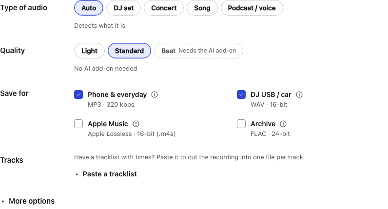
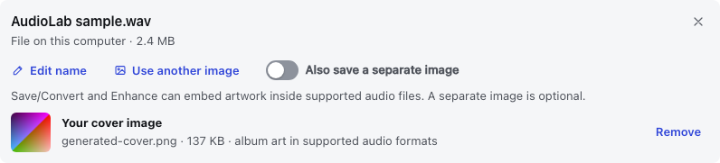
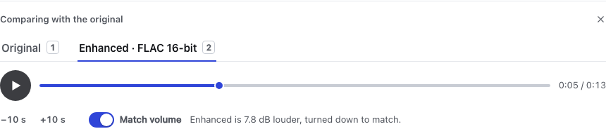

# Using AudioLab

For first-time setup, use the [Mac app guide](MACOS.md) or [source installation guide](INSTALLATION.md#install-from-source).

[First recording](#your-first-recording) · [Sources and results](#sources-and-results) ·
[Enhancement](#automatic-enhancement) · [Cover art](#cover-art) · [Compare versions](#compare-versions) · [Command line](#command-line) ·
[Home server](#docker--home-server) · [Server settings](#server-settings)

## Your first recording

1. Choose **New → Choose files** and select an audio file, or paste a supported web link and press **Load**.
2. Pick **Convert** for a file (**Save** for a link), **Enhance** to process it, or **Check** to inspect it. Defaults are a good
   starting point; **Light** enhancement mainly adjusts volume.
3. Press the main action button. Follow progress in **Activity**, then play or download the result.

Finished audio goes to **`Music/AudioLab`** in your home folder. Change that in **Settings → Files**.
Existing output files are kept; a new result gets a numbered name if needed. Removing a Library entry
preserves your output files, but may remove its kept original copy when no other entry uses it.
When enabled, kept original copies live separately in AudioLab's app-data folder and can also be
cleared in **Settings → Storage**.

See [optional AI](MACOS.md#optional-ai) for download progress, removal and hardware notes.
The add-on includes both model choices; local files can be processed offline once it is installed.

## Sources and results

Choose local audio/video files or paste a supported web link. Link availability depends on the source
site; a local file is the simplest starting point. For a playlist, choose the items to process.
Use only material you have permission to process.

- **Save / Convert:** convert formats, save an original stream, or cut chapters/a pasted tracklist into tracks.
- **Enhance:** choose a recipe or use Auto. Light quality mainly adjusts volume; Standard uses the
  recipe's processing; Best adds the optional AI stage.
- **Split:** produce vocals/instrumental or four stems using the optional AI pack.
- **Check:** inspect measurements and a spectrogram. Tempo, musical key and content type are estimates.
  Frequency range can suggest limitations; it cannot prove a file's encoding history.

**More options** holds format and processing controls. Edit title/artist names, add [cover art](#cover-art),
or choose several output formats. A multi-file result can be downloaded as a ZIP.

Library keeps Save, Enhance and Split results with their versions. When the original is kept, Enhance
offers full-length comparison with matched volume. Removing an entry does not delete the output files.
Kept originals use disk space separately from your output folder; manage them in Settings → Storage.

## Automatic enhancement



| Quality | What changes | Needs AI? |
|---|---|---|
| **Light** | Mainly loudness; keeps the original tone | No |
| **Standard** | Tone, dynamics and loudness using the chosen recipe | No |
| **Best** | Adds an AI stage to the recipe; takes longer | Yes |

Start with Light or Standard. “Best” is a processing choice, not a guarantee that you will prefer the sound.
The **Standard / Fine-tuned AI model** choice is separate from Enhance quality; see [hardware guidance](HARDWARE.md).

Auto chooses from the same recipes you can select yourself:

| Detected material | Recipe intent |
|---|---|
| DJ set / club mix | Club-oriented loudness, controlled bass, compression and peak control |
| Live recording | Gentle tone correction while preserving dynamics |
| Song / track | Conservative tone and loudness adjustments |
| Podcast / speech | Rumble filtering, clarity and more even volume |

The app explains its choices, and you can override them. Noise reduction is off unless you explicitly
choose it. Best quality can separate and recombine music stems or isolate speech before processing.
These operations may change the sound in ways you dislike; compare before choosing your preferred result.
Exporting a compressed source as WAV/FLAC does not restore missing detail.

## Cover art



AudioLab can put a picture **inside the audio file**, so compatible music players can show it as
album artwork. You do not need a separate picture file beside the song.

- For **Save / Convert** or **Enhance**, use **Use my own image** to choose a JPG, PNG or WebP.
  Your chosen picture takes priority over existing artwork.
- Without your own image, **Embed cover art** in **More options** uses a link's thumbnail or an
  audio file's existing cover, when available. This is on by default.
- Choose **MP3, M4A/AAC, Apple Lossless or FLAC** to embed artwork. AudioLab does not add covers
  to WAV or Opus; **Original** and video downloads are kept without new artwork.
- **Also save a separate image** is optional. It puts an extra image alongside the finished
  audio in your output folder; leave it off if you only want embedded artwork.

These choices create new output files; they do not retag your input file in place. Cover display
depends on the music player and its supported formats.

## Compare versions



Screenshots use generated sample audio; the displayed loudness difference is specific to that sample.

In **Library**, open a recording's versions and choose **Compare with the original** on an enhanced result.
This needs a kept original; **Settings → Storage → Keep originals for comparing** controls future jobs.

Press **Play**, then switch between **Original** and **Enhanced** to hear the same point in the recording.
Use the timeline or **−10 s / +10 s** to move around.
**Match volume** reduces the louder side for a fairer comparison. Turn it off to hear the actual level
difference. It changes playback only, not the saved files.

Choose **Compare with the original** on another enhanced version of the same recording to keep
your position, selected side and volume-matching choice. If you were playing, playback continues
after any brief buffering needed to load that version.
Switching to another recording or an ordinary file player starts a separate listening session.

Job pages may offer a shorter preview when a full comparison is unavailable. There is no Delta mode
in the current app; listening to Original and Enhanced is the supported comparison.

## Command line

From the project folder, the executable is `.venv/bin/audiolab` on macOS/Linux or
`.\.venv\Scripts\audiolab.exe` in Windows PowerShell. Substitute that path for `audiolab` below unless
your virtual environment is activated. Windows shells do not expand `*.mp3` like a POSIX shell;
pass explicit filenames there, or use the app's multi-file picker.

```bash
audiolab enhance recording.wav --light
audiolab enhance concert.flac --type live --formats wav16 flac24
audiolab separate song.flac --mode stems4 --format flac24
audiolab analyze recording.wav --json
audiolab download "https://example.org/recording.mp3" --format mp3
audiolab doctor --report
audiolab update
audiolab serve --port 8790
```

The link above is a placeholder; use a real supported link. `update` updates the downloader, not AudioLab.
Use `audiolab --help` or `audiolab enhance --help` for available options.

## Docker / home server

This is an advanced, experimental path. The desktop launchers are simpler for local use. Docker runtime
and GPU configurations have not been qualified in the current beta audit.

From the project folder, with Docker and Compose installed:

```bash
docker compose -f docker/compose.yml up -d --build
docker compose -f docker/compose.yml logs audiolab
```

Open `http://localhost:8088`. The logs contain the generated access token. The example includes the CPU
AI pack and can take longer to build. A separate NVIDIA example requires a compatible Linux host,
drivers and NVIDIA Container Toolkit:

```bash
docker compose -f docker/compose.cuda.yml up -d --build
```

Choose one Compose file, not both at once. The example mappings expose the app on the host's interfaces;
for access from other devices, use the host's address and the access token. Keep it on a trusted network
unless you configure appropriate access protection and HTTPS. Raw PCM comparison can transfer about
6.1 Mbit/s for both sides together, so remote listening may use substantial bandwidth.

Finished files are in **`output/` inside the project folder** by default. Settings, Library records,
kept originals and AI models are stored in the named `audiolab-data` volume. Preserve both when moving,
updating or removing the setup. Custom mappings change these locations.

To stop the CPU example without removing its stored data:

```bash
docker compose -f docker/compose.yml down
```

For the GPU example use `docker/compose.cuda.yml` instead. Do not add `--volumes` if you intend to keep
the app data. For limits and paths, see [server settings](#server-settings).

## Server settings

These environment variables are for command-line/server setups. Most desktop users can use Settings.

| Variable | Default | Meaning |
|---|---|---|
| `AUDIOLAB_OUTPUT_DIR` | `~/Music/AudioLab` | Where finished files go (locks the setting in the UI) |
| `AUDIOLAB_DATA_DIR` | platform app-data folder | Jobs, settings, tool shims |
| `AUDIOLAB_TOKEN` | auto when not on localhost | Access token; `none` disables it |
| `AUDIOLAB_MAX_CONCURRENT_JOBS` | 1 | Jobs processed at the same time |
| `AUDIOLAB_MAX_DURATION_S` | 28800 | Longest accepted recording |
| `AUDIOLAB_AI_CPU_MAX_DURATION_S` | 1200 | Longest AI job without a GPU (`AUDIOLAB_ALLOW_UNSAFE_AI=1` overrides) |
| `AUDIOLAB_MAX_UPLOAD_MB` / `AUDIOLAB_MAX_DOWNLOAD_MB` | 4096 | Size caps |
| `AUDIOLAB_MAX_PLAYLIST_ITEMS` | 200 | Playlist cap |
| `AUDIOLAB_MIN_FREE_DISK_GB` | 2 | Extra free-disk allowance added to the job's estimate; not a reservation |
| `AUDIOLAB_MEMORY_SAFETY_FRACTION` | 0.85 | Share of memory a job may plan to use |
| `AUDIOLAB_RETENTION_DAYS` | 30 | Delete old job records (never your output files) |

Timeouts can also be set: `AUDIOLAB_FFMPEG_TIMEOUT_S`, `AUDIOLAB_YTDLP_PROBE_TIMEOUT_S` and
`AUDIOLAB_YTDLP_DOWNLOAD_TIMEOUT_S`.
